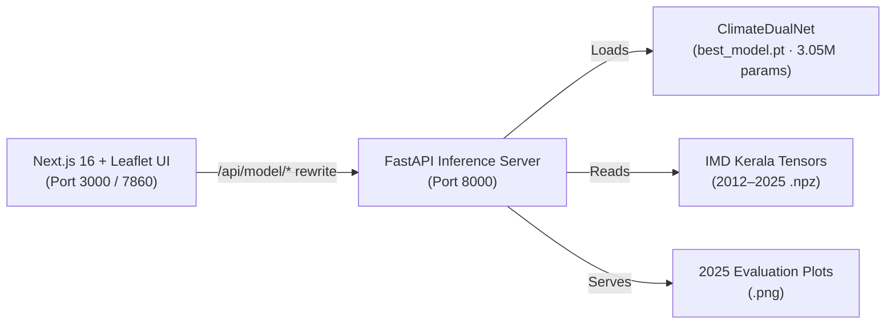

# 🌏 AI-Powered Digital Twin of India's Climate: Interactive Dashboard

[](https://digitaltwin-in.vercel.app/)
[](#hugging-face-spaces-deployment)
[](#)
[](#)

## 📌 Overview

This repository hosts the **Interactive Dashboard UI** and **FastAPI PyTorch Inference Backend** for the **AI-Powered Digital Twin of India's Climate** project.

It connects the trained **ClimateDualNet** spatiotemporal model (`3.05M` parameters, PyTorch) directly to an interactive Leaflet map and analytics dashboard over the **Kerala pilot domain** (`8.0°N–13.0°N`, `74.5°E–77.5°E`, `0.25° × 0.25°` resolution, `156` valid land cells) using official **IMD gridded daily datasets (2012–2025)** for:
- 🌧 **Rainfall** (`mm/day`)
- 🌡 **Maximum Temperature (Tmax)** (`°C`)
- 🌡 **Minimum Temperature (Tmin)** (`°C`)

---

## ✨ Key Features

- **Live 7-Day Spatiotemporal Forecasting (`ClimateDualNet`)**:
  - Uses a 30-day rolling history window to predict a 7-day horizon (`D+1` to `D+7`) across all 156 valid Kerala land grid cells.
  - Supports scrubbing across the full **2012–2025** timeline (2012–2024 training split & 2025 held-out validation split) with quick-jump presets (*2018 Floods*, *2024 Monsoon*, *2025 Val*).
- **Interactive Map Overlays**:
  - **Actual**: Ground-truth IMD observations.
  - **Predicted**: Live `ClimateDualNet` predictions.
  - **Δ Anomaly**: Spatial prediction error (`Predicted − Actual`).
  - **What-If Δ**: Spatial sensitivity map (`Simulated − Baseline`) from the What-If simulator.
- **What-If Sensitivity Simulator**:
  - Perturb **Rainfall Δ** (`-50` to `+100 mm`), **Tmax Δ** (`-10` to `+10 °C`), and **Tmin Δ** (`-10` to `+10 °C`) or select scenario presets (*Extreme Monsoon*, *Heatwave*, *Dry Spell*, *Warm & Wet*).
  - Runs live PyTorch inference on the perturbed 30-day input tensor and displays side-by-side 7-day baseline vs. simulated forecasts (labelled as model sensitivity analysis).
- **2025 Validation Diagnostics & Plots**:
  - Built-in diagnostics modal displaying 2025 unseen validation metrics (`RMSE`, `MAE`, `R²`, `Pearson`, `CSI`) and training/evaluation plots.

---

## 🏗️ System Architecture



---

## 🚀 Local Development

### Prerequisites
- **Node.js** 20+
- **Python** 3.10+ with `torch`, `fastapi`, `uvicorn`, `numpy`, `pydantic`
- Model weights and tensors placed in `ISRO_BAH_2026/` (gitignored; see structure below).

Required `ISRO_BAH_2026/` layout:
```text
ISRO_BAH_2026/
├── checkpoints/best_model.pt
├── normalization_stats.json
├── processed/stacked_tensor/
│   ├── train_tensor_kerala.npz
│   └── validation_tensor_kerala.npz
├── training_history/training_history.json   # optional (for diagnostics)
└── plots/*.png                              # optional (for diagnostics)
```

### 1. Start the PyTorch FastAPI Backend
```powershell
pip install -r requirements.txt
# Install PyTorch (CPU or CUDA) if not already installed:
# pip install torch --index-url https://download.pytorch.org/whl/cpu

python -m uvicorn backend.main:app --host 127.0.0.1 --port 8000
```

### 2. Start the Next.js Frontend
```powershell
npm install
npm run dev
```
Open [http://localhost:3000/dashboard](http://localhost:3000/dashboard) in your browser.

---

## 🤗 Hugging Face Spaces Deployment

This repository is pre-configured for **Hugging Face Spaces (Docker SDK)** on port `7860` via [Dockerfile](Dockerfile), [start.sh](start.sh), and the YAML frontmatter in this `README.md`.

Because `ISRO_BAH_2026/` contains large binary checkpoints and `.npz` tensors, it is excluded from git via `.gitignore`. To deploy to Hugging Face Spaces:

1. **Upload the model & dataset artifacts to a Hugging Face Model Repo** (e.g. `your-username/climate-digital-twin-kerala`) preserving the folder structure (`checkpoints/best_model.pt`, `normalization_stats.json`, `processed/stacked_tensor/*.npz`, `training_history/`, `plots/`):
   ```bash
   huggingface-cli upload your-username/climate-digital-twin-kerala ./ISRO_BAH_2026 .
   ```
2. **Create a new Hugging Face Space** selecting **Docker** as the Space SDK, and push or connect this repository.
3. **Set Space Variable**:
   - In your Space **Settings → Variables and secrets**, add:
     - `HF_MODEL_REPO` = `your-username/climate-digital-twin-kerala`
     - *(Optional, if private repo)* `HF_TOKEN` = your Hugging Face read token.
4. The container will automatically download the artifacts on startup, launch `uvicorn` on `127.0.0.1:8000`, and serve the Next.js dashboard on port `7860`.

---

## 🔗 Project Ecosystem Links

| Component | Resource Link |
|-----------|--------------|
| **UI Dashboard (Live Prototype)** | [digitaltwin-in.vercel.app](https://digitaltwin-in.vercel.app/) |
| **UI Source Code** | [github.com/anasalam-xyz/digital-twin](https://github.com/anasalam-xyz/digital-twin) |
| **Data Preprocessing Pipeline** | [github.com/aditya-raj9125/Digital-Twin](https://github.com/aditya-raj9125/Digital-Twin/tree/main) |
| **Model Training Notebook** | [Google Colab](https://colab.research.google.com/drive/1mf-kjpPhyaed0wkHWKu9GKIkK4DFwS6H?usp=sharing) |
| **Checkpoints & Diagnostic Plots** | [Google Drive Folder](https://drive.google.com/drive/folders/1efm85dzpRnf6ufU3qKhlyTZWFP1JGwMd?usp=sharing) |

---
*Developed as part of the AI-Powered Digital Twin of India's Climate Project.*
