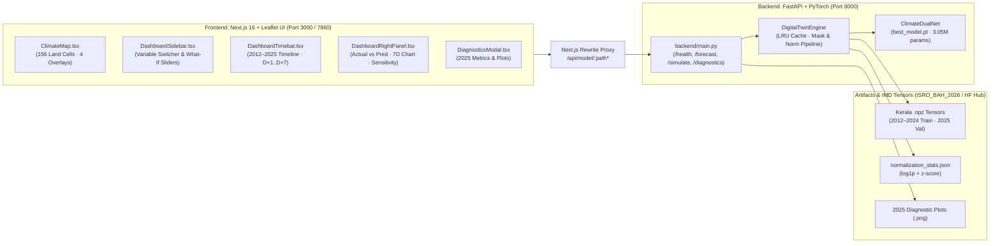
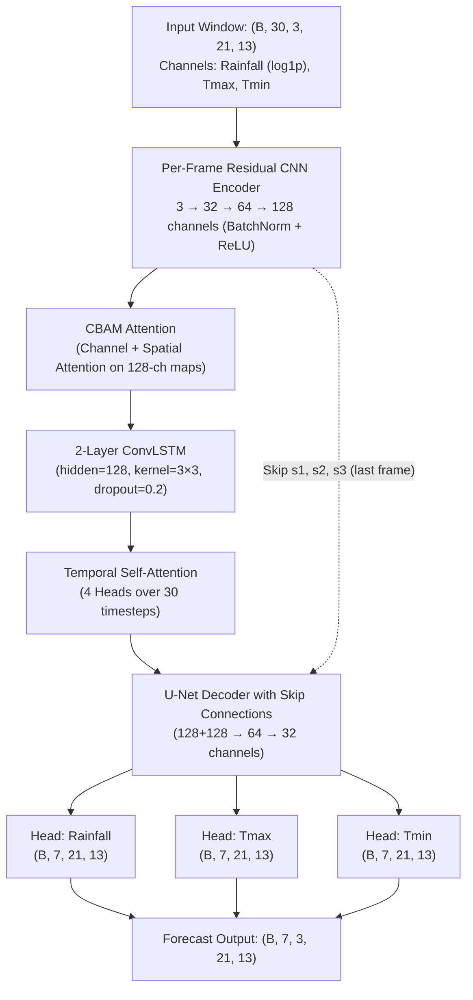
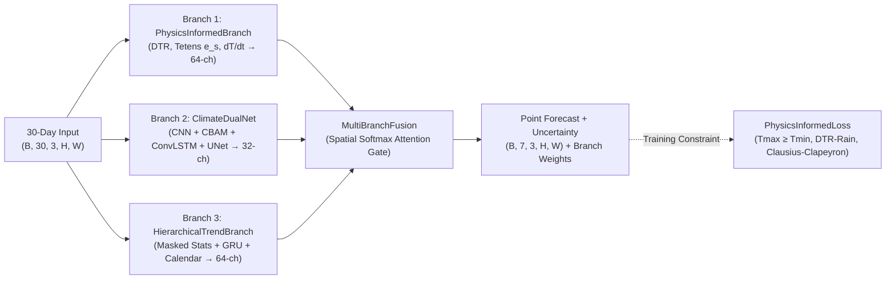
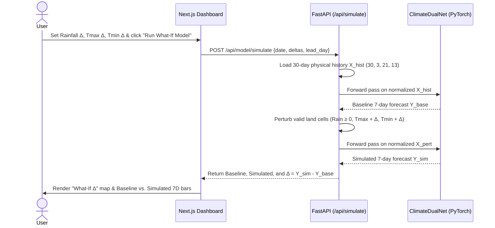

# 🌏 AI-Powered Digital Twin of India's Climate

[](https://digitaltwin-in.vercel.app/)
[](https://huggingface.co/Adityahars/climate-digital-twin-kerala)
[](#model-architecture)
[](#system-architecture)
[](#)

An end-to-end **Climate Digital Twin** for short-range (`1–7` day) spatiotemporal weather forecasting and interactive **"What-If" sensitivity analysis** over the **Kerala & Southern Peninsular India pilot domain** (`8.0°N–13.0°N`, `74.5°E–77.5°E`, `0.25° × 0.25°` grid, `156` valid land cells), built on official **India Meteorological Department (IMD)** daily gridded datasets (`2012–2025`).

---

## 📌 Key Capabilities

- **Live PyTorch Inference (`ClimateDualNet`, `3.05M` params):** Generates 7-day forecasts (`D+1` to `D+7`) for **Rainfall** (`mm/day`), **Maximum Temperature** (`Tmax`, `°C`), and **Minimum Temperature** (`Tmin`, `°C`) from a rolling 30-day historical window.
- **Interactive Geospatial Map (Leaflet):** Inspect all `156` valid `0.25° × 0.25°` land cells across four live overlays:
  - **Actual** — Ground-truth IMD gridded observations (`2012–2025`).
  - **Predicted** — Live `ClimateDualNet` model predictions.
  - **Δ Anomaly** — Spatial prediction residual (`Predicted − Actual`).
  - **What-If Δ** — Spatial sensitivity response (`Simulated − Baseline`).
- **Interactive What-If Sensitivity Simulator:** Perturb `Rainfall Δ` (`-50` to `+100 mm`), `Tmax Δ` (`-10` to `+10 °C`), and `Tmin Δ` (`-10` to `+10 °C`) — or apply presets (*Extreme Monsoon*, *Heatwave*, *Dry Spell*, *Warm & Wet*) — and re-run live `ClimateDualNet` inference to compare baseline vs. perturbed 7-day trajectories.
- **2025 Validation Diagnostics:** Built-in modal surfacing held-out 2025 evaluation metrics (`RMSE`, `MAE`, `R²`, `Pearson`, `CSI`) and `15` diagnostic plots.

---

## 🏗️ System Architecture

The application pairs a **Next.js 16 / React 19** interactive map frontend with a **FastAPI + PyTorch** inference backend connected via Next.js server rewrites (`/api/model/* → http://127.0.0.1:8000/api/*`).



---

## 🧠 Model Architecture

### Phase 1 (Active): `ClimateDualNet` — Spatiotemporal Branch (Branch 2)

The deployed model takes a normalized 30-day history tensor `(B, 30, 3, 21, 13)` and predicts the next 7 days `(B, 7, 3, 21, 13)`:



### Phase 2 (Scaffolded, Unwired): Multi-Branch Architecture (`backend/branches/`)

Standalone Phase 2 modules have been implemented under `backend/branches/` for future joint retraining (not yet wired into `ClimateDualNet` or live inference):



---

## 🔄 What-If Sensitivity Simulation Flow



> **Note:** Outputs from the What-If Simulator represent **model sensitivity analysis** (how `ClimateDualNet` responds to perturbed 30-day inputs), not physics-constrained climate projections.

---

## 📊 2025 Held-Out Validation Performance

Evaluated on unseen 2025 IMD data (`365` days, `156` valid land cells; from [evaluation_report.md](ISRO_BAH_2026/predictions/evaluation_report.md)):

| Variable | RMSE | MAE | R² | Pearson r | Bias |
|---|---:|---:|---:|---:|---:|
| **Rainfall** (`mm/day`) | `14.5408` | `5.5982` | `0.1478` | `0.5343` | `-4.2433` |
| **Max Temp (`Tmax`)** (`°C`) | `1.3064` | `1.0013` | `0.7506` | `0.8712` | `+0.0002` |
| **Min Temp (`Tmin`)** (`°C`) | `0.7885` | `0.5593` | `0.8654` | `0.9343` | `+0.1764` |

**Rainfall Critical Success Index (CSI):** `0.5832` (`≥ 0.1 mm`) · `0.5053` (`≥ 1.0 mm`) · `0.3447` (`≥ 5.0 mm`) · `0.2436` (`≥ 10.0 mm`).

---

## 🔌 Backend API Reference

| Endpoint | Method | Description |
|---|---|---|
| `/api/health` | `GET` | Model status, parameter count, device, date coverage, and grid shape |
| `/api/forecast?date=YYYY-MM-DD&lead_day=0..6` | `GET` | Live 7-day forecast vs. IMD actuals and 7-day history for all 156 land cells |
| `/api/simulate` | `POST` | Runs baseline vs. perturbed `ClimateDualNet` inference for What-If sensitivity |
| `/api/diagnostics` | `GET` | Returns 2025 validation metrics, training history, and available plot names |
| `/api/plots/{filename}` | `GET` | Serves diagnostic `.png` plots from `ISRO_BAH_2026/plots/` |

---

## 📁 Repository Structure

```text
digital-twin-ui/
├── app/
│   ├── page.tsx                        # Landing page
│   └── dashboard/page.tsx              # Interactive Digital Twin dashboard state & layout
├── components/dashboard/
│   ├── ClimateMap.tsx                  # Leaflet gridded map + 4 overlay modes
│   ├── DashboardSidebar.tsx            # Variable selector, What-If sliders & presets
│   ├── DashboardTimebar.tsx            # 2012–2025 timeline & D+1..D+7 horizon selector
│   ├── DashboardRightPanel.tsx         # Actual vs Pred, 7D bar chart & sensitivity stats
│   ├── DashboardTopbar.tsx             # Header, Kerala domain badge & live model status
│   └── DiagnosticsModal.tsx            # 2025 metrics & evaluation plot viewer
├── backend/
│   ├── model.py                        # ClimateDualNet PyTorch definition
│   ├── main.py                         # FastAPI inference & What-If server (+ HF Hub loader)
│   └── branches/                       # Standalone Phase 2 modules (unwired)
│       ├── physics_branch.py           # PhysicsInformedBranch & PhysicsInformedLoss
│       ├── hierarchical_trend_branch.py# HierarchicalTrendBranch
│       └── fusion.py                   # MultiBranchFusion (3-branch attention gate)
├── lib/climateTypes.ts                 # Shared TypeScript interfaces
├── next.config.ts                      # /api/model/* rewrite to FastAPI backend
├── Dockerfile                          # Multi-stage Docker build (Node 20 + Python 3.11)
├── start.sh                            # Container entrypoint (Uvicorn + Next.js on 7860)
└── requirements.txt                    # Python backend dependencies
```

---

## 🚀 Local Development

### Prerequisites
- **Node.js** `20+`
- **Python** `3.10+` with `torch`, `fastapi`, `uvicorn`, `numpy`, `pydantic`
- Model artifacts in `ISRO_BAH_2026/` (gitignored locally; auto-downloaded from Hugging Face Hub if `HF_MODEL_REPO` is set).

### 1. Start the FastAPI PyTorch Backend
```powershell
pip install -r requirements.txt
# Install PyTorch (CPU or CUDA) if not already installed:
# pip install torch==2.2.0 --index-url https://download.pytorch.org/whl/cpu

python -m uvicorn backend.main:app --host 127.0.0.1 --port 8000
```

### 2. Start the Next.js Frontend
```powershell
npm install
npm run dev
```
Open [http://localhost:3000/dashboard](http://localhost:3000/dashboard).

---

## 🤗 Hugging Face Deployment

- **Model & Data Artifacts:** Hosted at [Adityahars/climate-digital-twin-kerala](https://huggingface.co/Adityahars/climate-digital-twin-kerala).
- **Docker Space Setup:** [Dockerfile](Dockerfile) and [start.sh](start.sh) bundle the Next.js production server (port `7860`) and FastAPI backend (port `8000`) in one container. On startup, `backend/main.py` automatically downloads artifacts from `HF_MODEL_REPO` (defaults to `Adityahars/climate-digital-twin-kerala`) when `ISRO_BAH_2026/` is not present locally.

> **Note:** Hosting Docker Spaces on Hugging Face requires a PRO subscription; for free hosting, deploy the Next.js UI on Vercel and set `MODEL_API_URL` to a hosted `backend/` instance.

---

## 🔗 Project Ecosystem

| Component | Link |
|---|---|
| **Model Artifacts (HF Hub)** | [huggingface.co/Adityahars/climate-digital-twin-kerala](https://huggingface.co/Adityahars/climate-digital-twin-kerala) |
| **UI Prototype (Vercel)** | [digitaltwin-in.vercel.app](https://digitaltwin-in.vercel.app/) |
| **Data Preprocessing Pipeline** | [github.com/aditya-raj9125/Digital-Twin](https://github.com/aditya-raj9125/Digital-Twin/tree/main) |
| **Training Notebook** | [Google Colab](https://colab.research.google.com/drive/1mf-kjpPhyaed0wkHWKu9GKIkK4DFwS6H?usp=sharing) |

---
*Developed as part of the AI-Powered Digital Twin of India's Climate Project.*
